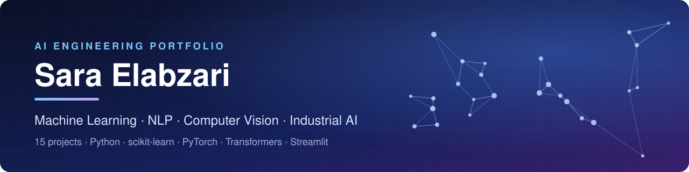

<p align="center">
  
</p>

<p align="center">
  <a href="https://github.com/Saraelabzari/Sara-AI-Engineering-Portfolio/actions/workflows/tests.yml"></a>
  
  
  
  
  <a href="https://www.linkedin.com/in/sarah-elabzari-64b214231"></a>
</p>

Applied AI projects across **industrial AI, machine learning, NLP and computer vision**. Each project is a self-contained Python package with its own README, requirements and an automated **pytest** suite. Wherever it applies, every model is measured against a simple baseline, so the results say how much the model actually adds.

---

## ⭐ Featured

| | Project | What it shows |
|---|---|---|
| 🛠️ | **[Predictive Maintenance — RUL](projects/predictive-maintenance-rul/)** | Remaining-useful-life regression and failure-risk alerts from multi-sensor data. Train/test split by machine (no leakage), fleet dashboard. RUL MAE 4.2 cycles vs 36.8 for the baseline. |
| ⚡ | **[Energy Load Forecasting](projects/energy-load-forecasting/)** | Hourly demand forecasting with lag, calendar and temperature features. Chronological evaluation that beats the seasonal-naive baseline (MAPE 2.2 % vs 2.9 %). |
| 🏭 | **[AI Cement Plant Intelligence](projects/project-01-cement-plant-ai/)** | Process forecasting and event review on real cement-plant DCS sensor data. |
| 🎙️ | **[Multilingual Speech-to-Text & Summarizer](projects/multilingual-speech-to-text-summarizer/)** | Whisper transcription plus Transformer summarization, with a Streamlit app. |

## 📂 All projects

### Industrial AI & forecasting
| Project | Focus | Stack |
|---|---|---|
| [Predictive Maintenance — RUL](projects/predictive-maintenance-rul/) | RUL regression and failure-risk classification | scikit-learn, pandas, Streamlit |
| [Energy Load Forecasting](projects/energy-load-forecasting/) | Hourly grid-demand forecasting | Gradient boosting, pandas, Streamlit |
| [AI Cement Plant Intelligence System](projects/project-01-cement-plant-ai/) | Industrial sensor analysis and process forecasting | Jupyter, pandas, scikit-learn |

### Machine learning & analytics
| Project | Focus | Stack |
|---|---|---|
| [Fraud Detection for Online Payments](projects/fraud-detection-online-payments/) | Imbalanced classification and precision-recall evaluation | scikit-learn, Matplotlib |
| [Customer Churn Prediction](projects/customer-churn-prediction/) | Customer classification pipeline | pandas, scikit-learn |
| [PCOS Prediction & Ultrasound Classification](projects/ultrasound-pcos-detection/) | Clinical-data ML comparison and an ultrasound CNN prototype | scikit-learn, XGBoost, PyTorch |
| [Product Recommendation Engine](projects/product-recommendation-engine/) | Content-based similarity ranking | TF-IDF, scikit-learn |
| [ML Model Comparison Dashboard](projects/ml-model-comparison-dashboard/) | Comparing baseline classifiers | Streamlit, scikit-learn |

### NLP & speech
| Project | Focus | Stack |
|---|---|---|
| [Multilingual Speech-to-Text & Summarizer](projects/multilingual-speech-to-text-summarizer/) | Transcription and summarization | Whisper, Transformers, Streamlit |
| [AI Chatbot for Customer Support](projects/ai-customer-support-chatbot/) | FAQ retrieval with a confidence fallback | TF-IDF, Streamlit |
| [Emotion Detection from Voice](projects/emotion-detection-from-voice/) | MFCC features and emotion classification | Librosa, scikit-learn |
| [Smart Home Voice Assistant](projects/smart-home-voice-assistant/) | Voice commands and simulated devices | SpeechRecognition, pyttsx3 |

### Computer vision
| Project | Focus | Stack |
|---|---|---|
| [Image Classification Pipeline](projects/image-classification-pipeline/) | ResNet-18 transfer learning | PyTorch, Torchvision |
| [ID Document Recognition](projects/id-document-recognition/) | Image preprocessing and OCR | OpenCV, Tesseract, Streamlit |
| [Face Detection Home Security](projects/face-detection-home-security/) | Real-time face detection | OpenCV |

---

## 🧪 Engineering practices

- **Tested:** every Python project has a pytest suite, and GitHub Actions runs all suites on every push.
- **Honest evaluation:** baselines, leak-free splits (by entity or by time), and metrics that fit the problem (PR-AUC for fraud, MAPE for load, RUL MAE).
- **Reusable code:** model logic lives in `src/`, while CLIs (`train.py`) and Streamlit apps are thin layers on top.
- **Reproducible:** fixed seeds, pinned dependency ranges, and synthetic data generators wherever public data isn't bundled.
- **Responsible:** privacy and limitation notes for medical, biometric and voice projects. No data, credentials or model weights are committed.

## 🚀 Run any project

```bash
git clone https://github.com/Saraelabzari/Sara-AI-Engineering-Portfolio.git
cd Sara-AI-Engineering-Portfolio/projects/<project-name>
python -m venv .venv && .venv\Scripts\activate      # macOS/Linux: source .venv/bin/activate
pip install -r requirements-dev.txt
python -m pytest            # run the tests
streamlit run app.py        # if the project has a dashboard
```

## 👩‍💻 About me

AI Engineer focused on **industrial AI**, which means bringing machine learning into plants, energy and infrastructure. I also build NLP, speech and computer-vision applications end to end: data, model, evaluation, app and tests.

📫 [LinkedIn](https://www.linkedin.com/in/sarah-elabzari-64b214231)

<sub>Portfolio projects are demonstrations and prototypes, not production-certified systems. Scores are only claimed where the dataset and evaluation are documented and reproducible.</sub>
