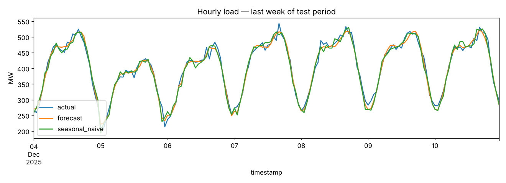

# Short-Term Energy Load Forecasting

Forecasts **hourly electricity demand (MW)** for an industrial or urban grid from calendar patterns, recent load history and temperature. Grid operators and large plants use this kind of day-ahead forecast to plan generation, avoid peak-demand penalties and schedule energy-heavy processes.



## What it does

- **Feature engineering:** hour, weekday and month, cyclic hour encoding, load lags at 24 h, 48 h and 168 h, a rolling 24 h mean, and temperature for cooling load.
- **Model:** a `HistGradientBoostingRegressor`, which is fast, handles non-linear temperature effects and needs no scaling.
- **Honest evaluation:** a strictly chronological train/test split with no shuffling. The model is compared with a seasonal-naive forecast (same hour last week), the standard baseline in load forecasting.
- **Metrics:** MAE, MAPE and peak-demand error. These are reported as numbers and saved as a plot.
- **Dashboard (Streamlit):** KPIs and an interactive forecast vs. actual chart. You can upload your own hourly CSV.
- **Works on its own:** a synthetic generator (daily and weekly seasonality, Friday/Saturday weekend, temperature-driven cooling load) makes every run reproducible.

## Results on synthetic data

Reproducible with `python src/train.py` (1 year of hourly data, last 28 days held out):

| Metric | Model | Seasonal-naive baseline |
|---|---|---|
| MAE | **8.6 MW** | 11.0 MW |
| MAPE | **2.23 %** | 2.90 % |

> These numbers come from synthetic data and show the method works. Real grids add holidays, outages and weather-forecast error. Validate with backtesting over several seasons before operational use.

## Quick start

```bash
python -m venv .venv
.venv\Scripts\activate          # Windows  (macOS/Linux: source .venv/bin/activate)
pip install -r requirements-dev.txt

python src/train.py              # train, print metrics, save reports/forecast_week.png
streamlit run app.py             # dashboard
python -m pytest tests/          # 6 tests (incl. a no-leakage check on lag features)
```

Use your own data: `python src/train.py --data data/load.csv`. The CSV needs `timestamp`, `load_mw` and optionally `temperature_c`.

## Project structure

```
src/forecasting.py   synthetic data, features, chronological split, model, metrics
src/train.py         CLI: train + evaluate + save plot, metrics and model
app.py               Streamlit dashboard
tests/               pytest suite
```

## Tech stack

Python · pandas · NumPy · scikit-learn · Matplotlib · Streamlit · pytest

## Next steps

- Use a weather-forecast feed instead of observed temperature, to get a true day-ahead setup.
- Add quantile regression (P10/P50/P90) for peak-risk planning.
- Run a rolling-origin backtest across all seasons.
